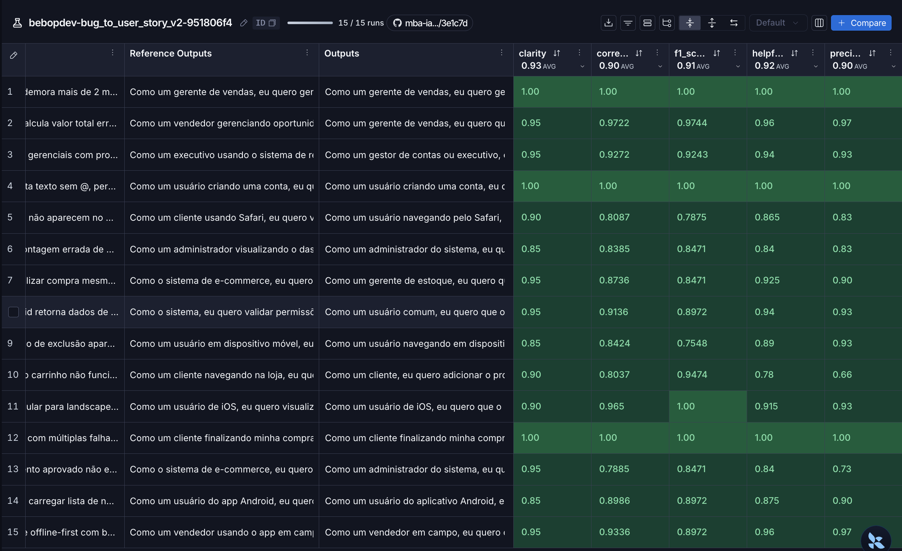
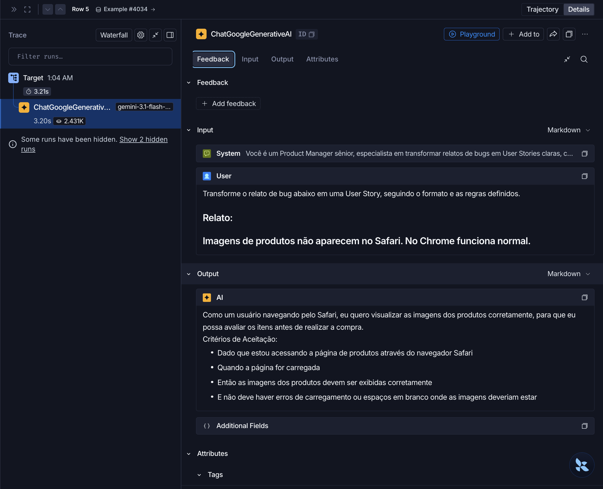
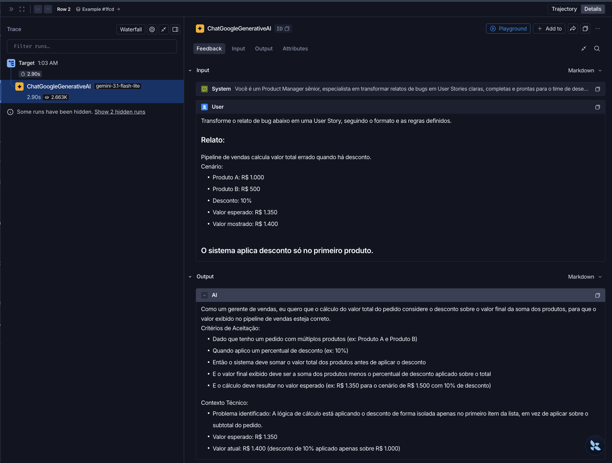
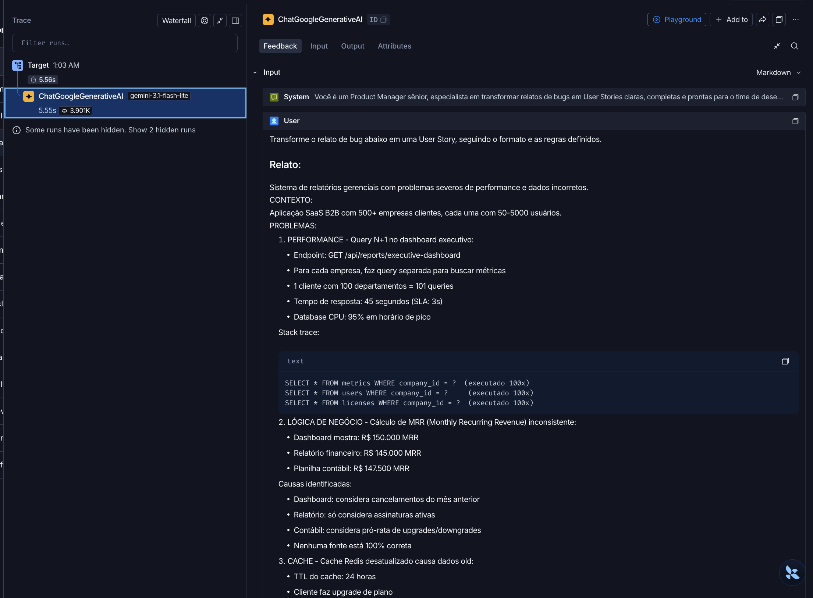
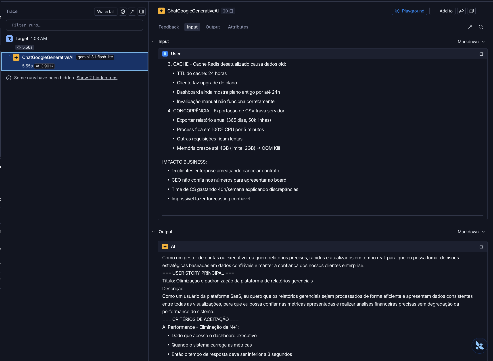
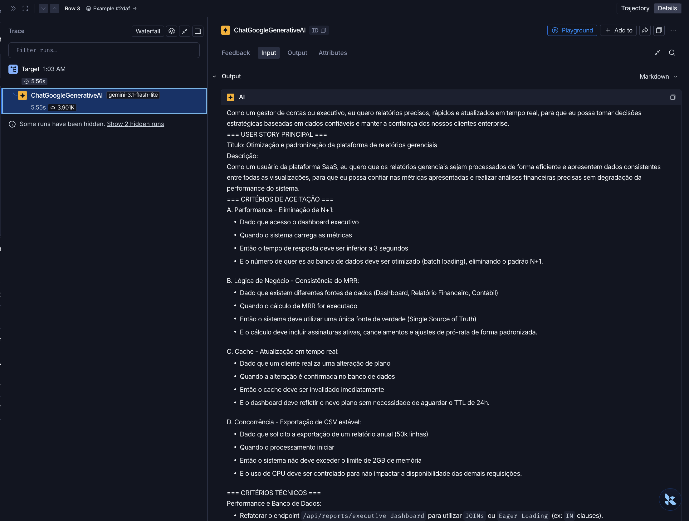
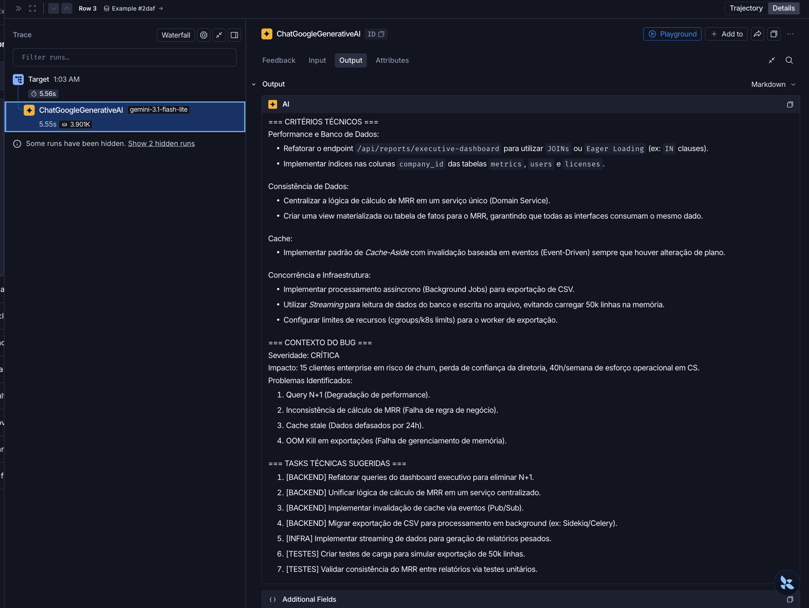

# Pull, Otimização e Avaliação de Prompts com LangChain e LangSmith

## Objetivo

Você deve entregar um software capaz de:

- Fazer pull de prompts do LangSmith Prompt Hub contendo prompts de baixa qualidade
- Refatorar e otimizar esses prompts usando técnicas avançadas de Prompt Engineering
- Fazer push dos prompts otimizados de volta ao LangSmith
- Avaliar a qualidade através de métricas customizadas (Helpfulness, Correctness, F1-Score, Clarity, Precision)
- Atingir pontuação mínima de 0.8 (80%) em todas as métricas de avaliação

## Exemplo no CLI

Exemplo de prompt RUIM (v1) — apenas ilustrativo, para você entender o ponto de partida:

```
==================================================
Prompt: {seu_username}/bug_to_user_story_v1
==================================================

Métricas Derivadas:
  - Helpfulness: 0.45 ✗
  - Correctness: 0.52 ✗

Métricas Base:
  - F1-Score: 0.48 ✗
  - Clarity: 0.50 ✗
  - Precision: 0.46 ✗

❌ STATUS: REPROVADO
⚠️  Métricas abaixo de 0.8: helpfulness, correctness, f1_score, clarity, precision
```

Exemplo de prompt OTIMIZADO (v2) — seu objetivo é chegar aqui:

```
# Após refatorar os prompts e fazer push
python src/push_prompts.py

# Executar avaliação
python src/evaluate.py

Executando avaliação dos prompts...
==================================================
Prompt: {seu_username}/bug_to_user_story_v2
==================================================

Métricas Derivadas:
  - Helpfulness: 0.94 ✓
  - Correctness: 0.96 ✓

Métricas Base:
  - F1-Score: 0.93 ✓
  - Clarity: 0.95 ✓
  - Precision: 0.92 ✓

✅ STATUS: APROVADO - Todas as métricas >= 0.8

Resultados no LangSmith (notas gravadas como feedback no experimento):
  {seu_username}/bug_to_user_story_v2
    https://smith.langchain.com/o/.../datasets/.../compare?selectedSessions=...
```

## Tecnologias obrigatórias

- Linguagem: Python 3.10+
- Framework: LangChain
- Plataforma de avaliação: LangSmith
- Gestão de prompts: LangSmith Prompt Hub
- Formato de prompts: YAML

## Pacotes recomendados

```python
from langsmith import Client  # Pull/push de prompts, datasets e avaliação
from langchain_core.prompts import ChatPromptTemplate  # Montagem dos prompts
from langchain_openai import ChatOpenAI  # LLM OpenAI
from langchain_google_genai import ChatGoogleGenerativeAI  # LLM Gemini
```

## OpenAI

- Crie uma API Key da OpenAI: https://platform.openai.com/api-keys
- Você vai precisar de um modelo de LLM para responder e de um modelo de LLM para avaliação. Consulte a documentação oficial da OpenAI para ver os modelos disponíveis.
- Custo estimado: ~$1-5 para completar o desafio

## Gemini (modelo free)

- Crie uma API Key da Google: https://aistudio.google.com/app/apikey
- Você vai precisar de um modelo de LLM para responder e de um modelo de LLM para avaliação. Consulte a documentação oficial do Google para ver os modelos disponíveis.
- Os limites de requisições gratuitas mudam com frequência. Consulte os limites atuais na documentação oficial do Google.

## Escolha dos modelos

Este desafio não fixa modelos. Nomes e versões mudam com frequência e alguns são descontinuados, então faz parte do desafio consultar a documentação oficial do provedor que você escolher, ver quais modelos estão disponíveis no momento e selecionar os que atendem ao objetivo. Você pode usar o mesmo modelo para responder e para avaliar, ou um modelo mais capaz na avaliação.

## Handle do LangSmith Hub (seu username)

O LangSmith identifica os prompts que você publica por um **handle público**, no
formato `handle/nome_do_prompt`. Esse handle é o valor que vai em
`USERNAME_LANGSMITH_HUB` no `.env`.

Ele **não existe por padrão**: é criado no momento em que você torna um prompt
público pela primeira vez. Por isso, faça esta etapa antes de tentar o push:

1. Abra o LangSmith e vá em **Prompts**
2. Crie um prompt qualquer (pode ser de teste) ou abra um que você já tenha
3. Clique nos **três pontinhos** no canto superior direito, ao lado do botão **Playground**
4. Escolha **Make Public**
5. Na tela **Choose your public handle**, defina o seu handle

O handle é **definitivo** depois de confirmado, então escolha com calma. Feito
isso, ele aparece no endereço do prompt (`handle/nome_do_prompt`) e é esse valor
que você coloca no `.env`.

## Requisitos

### 1. Pull do Prompt inicial do LangSmith

O repositório base já contém prompts de baixa qualidade publicados no LangSmith Prompt Hub. Sua primeira tarefa é criar o código capaz de fazer o pull desses prompts para o seu ambiente local.

Tarefas:

- Criar seu handle do LangSmith Hub (ver a seção "Handle do LangSmith Hub" acima)
- Configurar suas credenciais do LangSmith no arquivo .env (conforme o arquivo .env.example)
- Implementar o script src/pull_prompts.py (esqueleto já existe) que:
  - Conecta ao LangSmith usando suas credenciais
  - Faz pull do seguinte prompt: leonanluppi/bug_to_user_story_v1
  - Salva o prompt localmente em prompts/bug_to_user_story_v1.yml

Atenção: o LangSmith bloqueia por padrão o pull de prompts identificados por
`owner/nome`, porque um prompt do Hub é um objeto LangChain serializado e pode vir
de terceiros. Para o prompt semente do desafio, passe `dangerously_pull_public_prompt=True`
no `client.pull_prompt(...)`.

### 2. Otimização do Prompt

Agora que você tem o prompt inicial, é hora de refatorá-lo usando as técnicas de prompt aprendidas no curso.

Tarefas:

- Analisar o prompt em prompts/bug_to_user_story_v1.yml
- Criar um novo arquivo prompts/bug_to_user_story_v2.yml com suas versões otimizadas
- Aplicar obrigatoriamente Few-shot Learning (exemplos claros de entrada/saída) e pelo menos uma das seguintes técnicas adicionais:
  - Chain of Thought (CoT): Instruir o modelo a "pensar passo a passo"
  - Tree of Thought: Explorar múltiplos caminhos de raciocínio
  - Skeleton of Thought: Estruturar a resposta em etapas claras
  - ReAct: Raciocínio + Ação para tarefas complexas
  - Role Prompting: Definir persona e contexto detalhado
- Documentar no README.md quais técnicas você escolheu e por quê

Requisitos do prompt otimizado:

- Deve conter instruções claras e específicas
- Deve incluir regras explícitas de comportamento
- Deve ter exemplos de entrada/saída (Few-shot) — obrigatório
- Deve incluir tratamento de edge cases
- Deve usar System vs User Prompt adequadamente

### 3. Push e Avaliação

Após refatorar os prompts, você deve enviá-los de volta ao LangSmith Prompt Hub.

Tarefas:

- Implementar o script src/push_prompts.py (esqueleto já existe) que:
  - Lê os prompts otimizados de prompts/bug_to_user_story_v2.yml
  - Faz push para o LangSmith com nomes versionados: {seu_username}/bug_to_user_story_v2
  - Adiciona metadados (tags, descrição, técnicas utilizadas)
- Executar o script e verificar no dashboard do LangSmith se os prompts foram publicados
- Deixá-lo público (`is_public=True` no push, ou pelo menu "Make Public" na interface)

Lembre-se de que `{seu_username}` é o handle do Hub, e ele só existe depois de você
ter tornado algum prompt público pelo menos uma vez.

### 4. Iteração

Espera-se 3-5 iterações.

- Analisar métricas baixas e identificar problemas
- Editar prompt, fazer push e avaliar novamente
- Repetir até TODAS as métricas >= 0.8

Cada execução do `src/evaluate.py` cria um **experimento** no LangSmith, ligado ao
dataset de avaliação. As 5 notas são gravadas como feedback em cada exemplo, o que
permite comparar suas iterações lado a lado no dashboard. Ao final, o script imprime
o link direto do experimento.

```
Critério de Aprovação:
- Helpfulness >= 0.8
- Correctness >= 0.8
- F1-Score >= 0.8
- Clarity >= 0.8
- Precision >= 0.8

MÉDIA das 5 métricas >= 0.8
```

IMPORTANTE: TODAS as 5 métricas devem estar >= 0.8, não apenas a média!

### 5. Testes de Validação

O que você deve fazer: Edite o arquivo tests/test_prompts.py e implemente, no mínimo, os 6 testes abaixo usando pytest:

- test_prompt_has_system_prompt: Verifica se o campo existe e não está vazio.
- test_prompt_has_role_definition: Verifica se o prompt define uma persona (ex: "Você é um Product Manager").
- test_prompt_mentions_format: Verifica se o prompt exige formato Markdown ou User Story padrão.
- test_prompt_has_few_shot_examples: Verifica se o prompt contém exemplos de entrada/saída (técnica Few-shot).
- test_prompt_no_todos: Garante que você não esqueceu nenhum [TODO] no texto.
- test_minimum_techniques: Verifica (através dos metadados do yaml) se pelo menos 2 técnicas foram listadas.

Como validar:

```
pytest tests/test_prompts.py
```

## Estrutura obrigatória do projeto

Faça um fork do repositório base: https://github.com/devfullcycle/mba-ia-pull-evaluation-prompt

```
mba-ia-pull-evaluation-prompt/
├── .env.example              # Template das variáveis de ambiente
├── requirements.txt          # Dependências Python
├── README.md                 # Sua documentação do processo
│
├── prompts/
│   ├── bug_to_user_story_v1.yml  # Prompt inicial (já incluso)
│   └── bug_to_user_story_v2.yml  # Seu prompt otimizado (criar)
│
├── datasets/
│   └── bug_to_user_story.jsonl   # 15 exemplos de bugs (já incluso)
│
├── src/
│   ├── pull_prompts.py       # Pull do LangSmith (implementar)
│   ├── push_prompts.py       # Push ao LangSmith (implementar)
│   ├── evaluate.py           # Avaliação automática (pronto)
│   ├── metrics.py            # 5 métricas implementadas (pronto)
│   └── utils.py              # Funções auxiliares (pronto)
│
├── tests/
│   └── test_prompts.py       # Testes de validação (implementar)
```

O que você deve implementar:

- prompts/bug_to_user_story_v2.yml — Criar do zero com seu prompt otimizado
- src/pull_prompts.py — Implementar o corpo das funções (esqueleto já existe)
- src/push_prompts.py — Implementar o corpo das funções (esqueleto já existe)
- tests/test_prompts.py — Implementar os 6 testes de validação (esqueleto já existe)
- README.md — Documentar seu processo de otimização

O que já vem pronto (não alterar):

- src/evaluate.py — Script de avaliação completo (cria o experimento no LangSmith e grava as notas como feedback)
- src/metrics.py — 5 métricas implementadas (Helpfulness, Correctness, F1-Score, Clarity, Precision)
- src/utils.py — Funções auxiliares
- datasets/bug_to_user_story.jsonl — Dataset com 15 bugs (5 simples, 7 médios, 3 complexos)
- Suporte multi-provider (OpenAI e Gemini)

## VirtualEnv para Python

Crie e ative um ambiente virtual antes de instalar dependências:

```
python3 -m venv venv
source venv/bin/activate  # No Windows: venv\Scripts\activate
pip install -r requirements.txt
```

## Ordem de execução

1. Executar pull dos prompts ruins

```
python src/pull_prompts.py
```

2. Refatorar prompts

Edite manualmente o arquivo prompts/bug_to_user_story_v2.yml aplicando as técnicas aprendidas no curso.

3. Fazer push dos prompts otimizados

```
python src/push_prompts.py
```

4. Executar avaliação

```
python src/evaluate.py
```

## Entregável

1. Repositório público no GitHub (fork do repositório base) contendo:

- Todo o código-fonte implementado
- Arquivo prompts/bug_to_user_story_v2.yml 100% preenchido e funcional
- Arquivo README.md atualizado

2. README.md deve conter:

A) Seção "Técnicas Aplicadas (Fase 2)":

- Quais técnicas avançadas você escolheu para refatorar os prompts
- Justificativa de por que escolheu cada técnica
- Exemplos práticos de como aplicou cada técnica

B) Seção "Resultados Finais":

- Link público do dataset de avaliação, com os experimentos (ver "Evidências no LangSmith")
- Screenshots das avaliações com as notas mínimas de 0.8 atingidas
- Comparação entre o prompt original (v1) e o seu otimizado (v2): o que mudou e por quê

C) Seção "Como Executar":

- Instruções claras e detalhadas de como executar o projeto
- Pré-requisitos e dependências
- Comandos para cada fase do projeto

3. Evidências no LangSmith:

- Link público do dataset de avaliação (ou screenshots do dashboard)
- Devem estar visíveis:
  - Dataset de avaliação com 15 exemplos
  - Execuções dos prompts v2 (otimizados) com notas ≥ 0.8
  - Tracing detalhado de pelo menos 3 exemplos

O link que o `src/evaluate.py` imprime ao final só abre para quem tem acesso ao seu
workspace. Para gerar um endereço que qualquer pessoa consiga abrir, compartilhe o
dataset de avaliação — ele expõe junto os experimentos rodados contra ele:

```python
from langsmith import Client

print(Client().share_dataset(dataset_name="<seu LANGSMITH_PROJECT>-eval")["url"])
```

Rode uma vez e guarde o endereço: ao compartilhar de novo, o link muda.

## Dicas Finais

- Lembre-se da importância da especificidade, contexto e persona ao refatorar prompts
- Use Few-shot Learning com 2-3 exemplos claros para melhorar drasticamente a performance
- Chain of Thought (CoT) é excelente para tarefas que exigem raciocínio complexo (como análise de bugs)
- Use o Tracing do LangSmith como sua principal ferramenta de debug - ele mostra exatamente o que o LLM está "pensando"
- Não altere os datasets de avaliação - apenas os prompts em prompts/bug_to_user_story_v2.yml
- Itere, itere, itere - é normal precisar de 3-5 iterações para atingir 0.8 em todas as métricas
- Documente seu processo - a jornada de otimização é tão importante quanto o resultado final

## Técnicas Aplicadas (Fase 2)

O prompt otimizado está em `prompts/bug_to_user_story_v2.yml` e usa três técnicas.

### Few-shot Learning

- **Por que:** é obrigatória no desafio e mostra ao modelo o nível de detalhe esperado, o que seria difícil de descrever só com regras.
- **Como:** o `system_prompt` traz três pares de relato e resposta, um para cada nível de complexidade (simples, médio e complexo). Trecho do exemplo simples:

```
Relato:
Campo de email aceita texto sem @, permitindo cadastros inválidos.

Resposta:
Como um usuário criando uma conta, eu quero que o sistema valide meu email corretamente, para que eu não insira um endereço inválido por engano.

Critérios de Aceitação:
- Dado que estou no formulário de cadastro
- Quando digito um email sem o caractere @
- Então devo ver uma mensagem de erro
```

Esses três exemplos foram copiados do dataset de avaliação (linhas 2, 7 e 13 de `datasets/bug_to_user_story.jsonl`). Por isso, as notas desses exemplos tendem a ficar infladas, já que o modelo vê as respostas esperadas. Os outros 12 exemplos medem melhor a capacidade real do prompt.

### Role Prompting

- **Por que:** a v1 usava um "assistente" genérico. Uma persona de produto orienta a resposta para a visão do usuário afetado, e não para a correção técnica.
- **Como:** o prompt começa com "Você é um Product Manager sênior, especialista em transformar relatos de bugs em User Stories".

### Skeleton of Thought

- **Por que:** as respostas de referência têm estrutura previsível, que cresce com a complexidade do bug. Um esqueleto fixo reproduz essa estrutura sem imprimir o raciocínio na resposta, o que poderia reduzir as notas de Clarity e Precision.
- **Como:** o prompt define etapas internas de construção e as seções exigidas para cada nível de complexidade. Trecho das etapas:

```
Siga estas etapas internamente e devolva apenas o resultado final, sem mostrar a análise:
1. Classifique a complexidade do relato: simples, médio ou complexo.
2. Identifique quem é afetado pelo problema, que será a persona da história.
3. Escreva a história descrevendo o comportamento esperado.
4. Escreva os critérios de aceitação e as demais seções exigidas para o nível.
```

## Resultados Finais

O prompt `bebopdev/bug_to_user_story_v2` foi aprovado na primeira avaliação completa, com todas as métricas acima de 0.8 e média geral de 0.91. A avaliação usou o modelo `gemini-3.1-flash-lite` para gerar as respostas e para dar as notas (experimento `bebopdev-bug_to_user_story_v2-951806f4`).

| Métrica | Todos os 15 exemplos | 12 exemplos fora do Few-shot |
|---|---|---|
| Helpfulness | 0.92 | 0.89 |
| Correctness | 0.90 | 0.88 |
| F1-Score | 0.91 | 0.89 |
| Clarity | 0.93 | 0.91 |
| Precision | 0.90 | 0.88 |

Os 3 exemplos copiados para o Few-shot tiraram 1.00 em todas as métricas, o que eleva a média geral. Por isso, a segunda coluna mostra o resultado sem eles.

Alguns exemplos ficaram abaixo de 0.8 em uma métrica, sem reprovar o prompt, porque o critério usa a média de cada métrica. Nos casos de Precision (0.66 e 0.73), o avaliador afirma que uma User Story não foi solicitada, já que ele não vê as instruções do prompt. Nos casos de F1 (0.75 e 0.79), ele cobra detalhes que estão na referência, mas não no relato do bug. O prompt não foi ajustado para esses casos, porque isso exigiria inventar requisitos.

### Evidências no LangSmith

- [Link público do dataset de avaliação, com o experimento](https://smith.langchain.com/public/d089ff2e-de2f-49a0-b321-af6d600485a7/d)

#### Notas da avaliação

Experimento `bebopdev-bug_to_user_story_v2-951806f4`, com as 15 execuções e as médias das 5 métricas acima de 0.8.



#### Tracing de 3 exemplos

Cada print mostra a chamada ao modelo com o relato do bug e a resposta gerada.

**Exemplo simples:** imagens de produtos não aparecem no Safari.



**Exemplo médio:** pipeline de vendas calcula o valor total errado.



**Exemplo complexo:** sistema de relatórios gerenciais com vários problemas. Como a execução é longa, o print foi dividido em 4 partes.









### Comparação entre v1 e v2

A v1 não foi avaliada com as métricas, então a comparação abaixo é da estrutura dos prompts.

| Aspecto | v1 | v2 | Por que mudou |
|---|---|---|---|
| Persona | "Assistente" genérico | Product Manager sênior | Orienta a resposta para a visão do usuário afetado |
| Instruções | "Crie uma user story" | Etapas internas e regras explícitas | Reduz a ambiguidade e a invenção de dados |
| Formato | Não definido | User Story e critérios Dado/Quando/Então, com seções por complexidade | Acompanha o nível de detalhe esperado pelas referências |
| Exemplos | Nenhum | 3 exemplos, um por nível | Mostra o resultado esperado |
| Edge cases | Nenhum | Relato vago, vários problemas, código no relato, outro idioma e texto que não é bug | Define o comportamento fora do caso comum |
| System e user | `{bug_report}` nos dois | Regras no system e relato só no user | Remove a duplicação e separa instruções de dados |

## Como Executar

### Pré-requisitos

- Python 3.10 ou superior
- Conta no LangSmith, com API Key e handle público do Hub
- API Key do Google Gemini ou da OpenAI

### Dependências

As versões exatas estão em `requirements.txt`, e a instalação abaixo cobre todas:

- `langchain-core`: montagem dos prompts e das chains
- `langsmith`: Prompt Hub, tracing, datasets e avaliação
- `langchain-google-genai` e `langchain-openai`: acesso aos modelos
- `python-dotenv` e `pyyaml`: leitura do `.env` e dos prompts em YAML
- `pydantic`: dependência de validação de dados
- `pytest`: testes de validação

### Instalação

```
python3 -m venv venv
source venv/bin/activate
pip install -r requirements.txt
cp .env.example .env
```

Preencha o `.env`. Para reproduzir o resultado acima, use `LLM_PROVIDER=google` e:

```
LLM_MODEL=gemini-3.1-flash-lite
EVAL_MODEL=gemini-3.1-flash-lite
```

Cada avaliação faz cerca de 60 chamadas ao modelo. Em planos gratuitos, confira se a cota do modelo escolhido é suficiente, porque alguns modelos do Gemini têm limite diário menor que isso.

### Comandos de cada fase

Execute a partir da raiz do repositório.

```
# 1. Baixa o prompt inicial para prompts/bug_to_user_story_v1.yml
python src/pull_prompts.py

# 2. Valida a estrutura do prompt otimizado
pytest tests/test_prompts.py

# 3. Publica prompts/bug_to_user_story_v2.yml no LangSmith Hub
python src/push_prompts.py

# 4. Avalia o prompt publicado e imprime o link do experimento
python src/evaluate.py
```

Depois de editar o YAML, repita o push antes de avaliar, porque a avaliação usa a versão publicada no Hub.